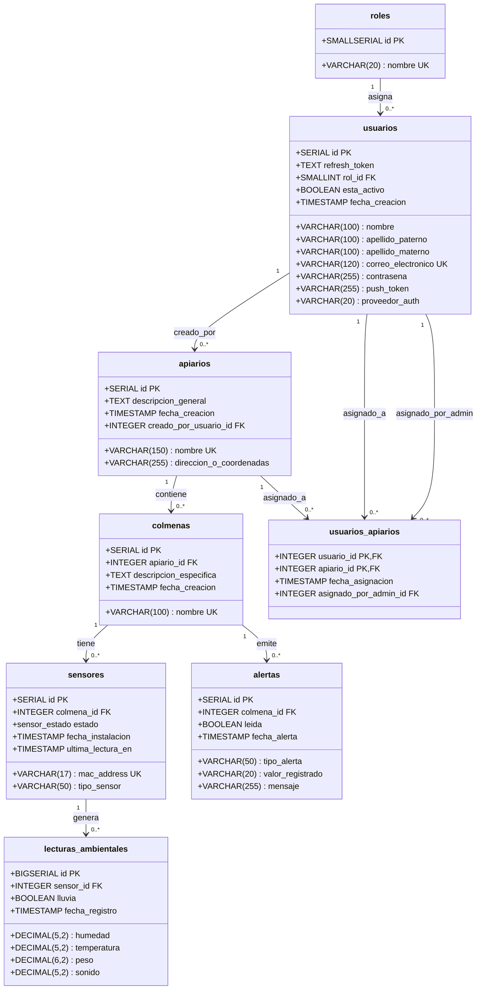

# AbejaNet v4 — Diagrama de Base de Datos (PostgreSQL)

Diagrama completo generado a partir de [`abeja_net_v4_postgres.sql`](../abeja_net_v4_postgres.sql).

## Vista general del modelo

## Descripción de tablas

### 1. Autenticación y permisos

| Tabla | Descripción |
|-------|-------------|
| `roles` | Catálogo de roles: administrador y usuario. |
| `usuarios` | Cuentas de usuario, credenciales hasheadas con bcrypt, tokens JWT/push, proveedor de auth (local/google) y rol. |

### 2. Gestión de apiarios y colmenas

| Tabla | Descripción |
|-------|-------------|
| `apiarios` | Ubicaciones físicas donde se instalan las colmenas. Registra creador y coordenadas. |
| `colmenas` | Colmenas individuales pertenecientes a un apiario. |
| `usuarios_apiarios` | Relación muchos-a-muchos entre usuarios y apiarios. Incluye auditoría de quién asignó el acceso. |

### 3. IoT, lecturas y alertas

| Tabla | Descripción |
|-------|-------------|
| `sensores` | Dispositivos ESP32 identificados por MAC. Pueden estar activos, inactivos, en mantenimiento o sin asignar. |
| `lecturas_ambientales` | Datos históricos de humedad, temperatura, peso, sonido y lluvia generados por cada sensor. |
| `alertas` | Notificaciones generadas por colmena (temperatura alta, peso bajo, etc.). |

## Archivo HTML interactivo

También existe una versión navegable en [`docs/diagrama_bd.html`](./diagrama_bd.html).

---

AbejaNet Revival · UTEQ · IDGS 16
